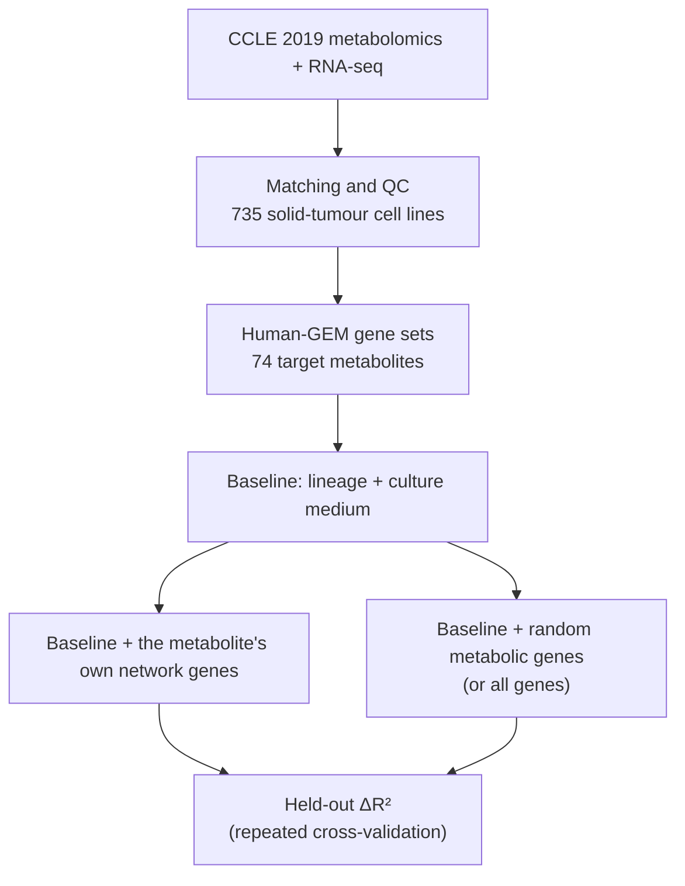
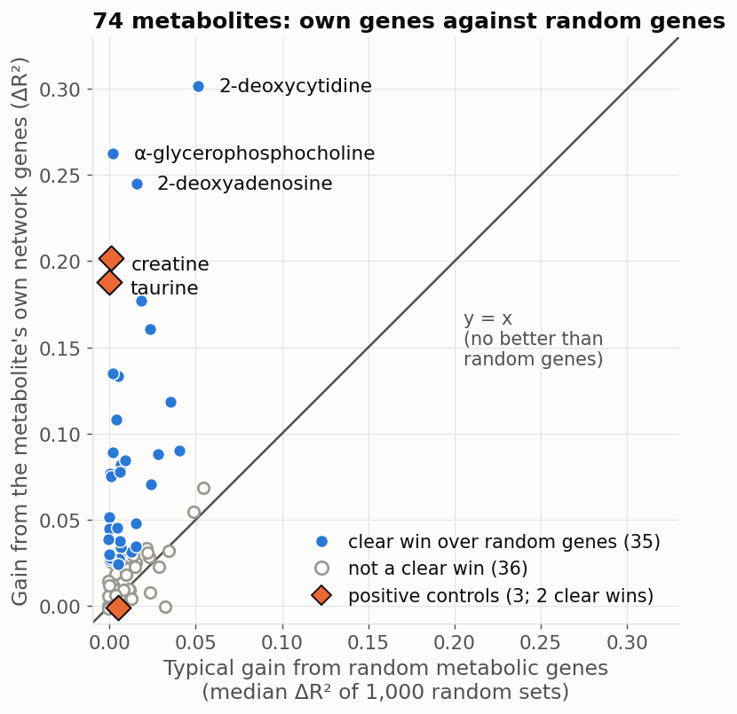

# MetaboNet

**Author:** Arda Alpay

*Cells build, use and move thousands of small molecules; this project tests whether the activity of the genes that handle a molecule predicts how much of it a cancer cell line contains.*

## Result in one line

For 37 of 74 pre-specified polar metabolites in 735 CCLE solid-tumour cell lines, genes in the metabolite's Human-GEM reaction neighbourhood improved held-out prediction beyond lineage and culture medium, more than size-matched random metabolic genes (pre-specified, frozen in a dated git commit; robust in four sensitivity analyses). A post hoc check showed these sets also beat non-overlapping gene sets from other metabolites (33 of 33 judged).

## The idea in 30 seconds

Every small molecule in a cell is made, used up or moved by a few enzymes and transporters, and each one is encoded by a known gene. If those genes are more active in a cell line, you might expect more (or less) of the molecule there. I tested this for 74 molecules in 735 cancer cell lines, always predicting cell lines the model had not seen, after accounting for tissue type and growth medium. The hypotheses and the list of molecules were fixed before any model was run, and every result is compared with randomly chosen genes.

## How it works



## Key figure



*Dots above the line: the metabolite's own network genes predict it better than random genes.*

## What I found

- **Network genes add information (H1).** Beyond lineage and medium, the median gain in held-out R² is 0.029, and 51 of 74 metabolites (69%) gain at least 0.02 (p = 7e-14).
- **More than chance (H2).** 37 of 74 metabolites clearly beat randomly chosen metabolic genes of the same size; 39 exceed the 95th percentile of their own random sets, where about 3.7 would by chance.
- **Larger than I predicted, so I checked it.** I wrote down 10–25% of metabolites beforehand and found 50%. Checks: a permuted-target control shows no signal, an independent re-implementation agrees to about 1e-15, and the result holds with variance-matched random sets, with gene sets from other pathways (post hoc), and in four sensitivity analyses.
- **One control failed, and I think I know why.** Kynurenine shows no signal (ΔR² = −0.001, p = 0.87). The most likely reason, untested here, is that the enzymes that control it (IDO1 and TDO2) sit one step outside its gene set, and they are expressed in only 18% and 30% of the cell lines.

## Main limitations

1. **Association, not causation.** RNA and metabolites were measured in different cultures, and messenger RNA is only a proxy for enzyme activity.
2. **Only 74 of the 225 measured metabolites could be tested:** those with a confident one-to-one model match and a compact gene neighbourhood. There is no independent dataset.
3. **A mean-expression filter removes genes expressed strongly in only a subset of lines (e.g. IDO1, TDO2), which can be the most informative ones.**

## Glossary

- **ΔR² (gain in R²):** how much better the predictions are than the baseline, scored on held-out cell lines. 0 means no gain.
- **Baseline:** prediction from tissue type (lineage) and growth medium alone.
- **Null / random gene set:** randomly chosen genes, the same number as the real set, put through the identical procedure. It shows what chance achieves.
- **First-neighbour gene set:** the genes of the enzymes and transporters in the reactions that directly make, use or move the metabolite, taken from the Human-GEM metabolic model.
- **GPR (gene–protein–reaction rule):** the model's rule linking genes to a reaction (AND = a protein complex, OR = alternative enzymes).
- **Cross-validation:** repeatedly hiding a fifth of the cell lines, fitting on the rest, and scoring on the hidden ones (here 5 folds × 10 repeats).
- **Pre-specification:** hypotheses, target list and thresholds written down and frozen in a dated git commit before any model was fitted. They were not filed with an external registry.

## Read more

- **[Final report](docs/report.md):** question, design, all results, limitations, deviations. Start here.
- **[Case studies](docs/case_studies.md):** 2-deoxycytidine (top result), creatine (control that passes), kynurenine (control that fails).
- **Phase reports:** [data audit](docs/data_audit_report.md), [network and targets](docs/phase1_report.md), [pipeline and controls](docs/phase2_report.md), [main results](docs/phase3_report.md).
- **Specification and trail:** [research plan](docs/research_plan.md), [pre-specified hypotheses](docs/expectations.md), [literature review](docs/literature_review.md), [decision log](docs/decision_log.md), [data sources and checksums](docs/data_sources.md).

<details>
<summary>Folder map</summary>

```
docs/            report, case studies, phase reports, plan, hypotheses, decision log
src/phase0/      data download and audit, cell-line matching, medium normalisation
src/phase1/      Human-GEM parsing, gene and metabolite mapping, gene sets, target selection
src/phase2/      cross-validation folds, ridge model, controls (run_target = main entry point)
src/phase3/      main and sensitivity runs, statistics, post hoc check, figures
src/phase4/      case studies and their figures
data/raw/        downloaded files (not committed; provenance and checksums in MANIFEST.tsv)
data/processed/  frozen tables with hashes (cell lines, mappings, gene sets, targets)
data/curation/   hand-curated identifier and annotation tables
results/         folds, per-target results, statistics, figures
notebooks/       executed data-audit notebook
tests/           89 unit tests
scripts/         documentation checks (links, numbers, paths)
```

</details>

<details>
<summary>Reproduce</summary>

Needs Python 3.10 and the `uv` package manager. Versions are pinned in `requirements.txt` and `requirements.lock`.

```bash
make env            # create the pinned environment (.venv)
# Manual step: the DepMap portal blocks scripts. Download Model.csv and README.txt
# of one DepMap release into data/raw/depmap/ and write RELEASE.txt
# (details: docs/data_sources.md).
make data           # download the other inputs and write checksums
make test           # 89 unit tests
make all            # audit and phases 1-4 (about 5 hours; thread count is fixed for identical results)
make verify-results # check stored result arrays against their hashes
make check-docs     # check links, paths and the numbers quoted in this README
```

Raw data and the large result arrays are not committed; every stage can be regenerated from the pinned inputs. The complete `make all` chain was run stage by stage, not in one go from an empty checkout (see the report, section 9).

</details>

## How this was built

*To be written by the author: what I decided myself (question, hypotheses, design choices, what to do when results surprised me) and what was implemented with AI assistance.*

## Licence and data

The code is released under the [MIT licence](LICENSE). The data are **not** covered by it: CCLE and DepMap data, the Human-GEM model and Cellosaurus records remain under their providers' original terms, and the raw files are not redistributed here. Tables in `data/processed/` and `results/` that are derived from those sources stay subject to the same terms. See [data sources](docs/data_sources.md).
