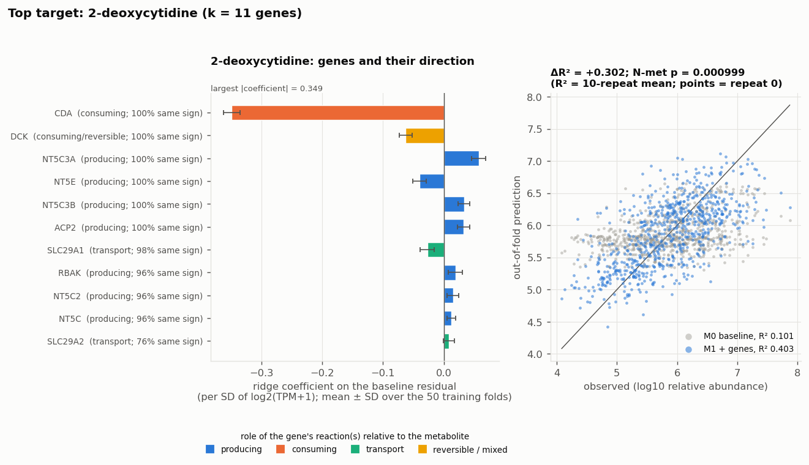
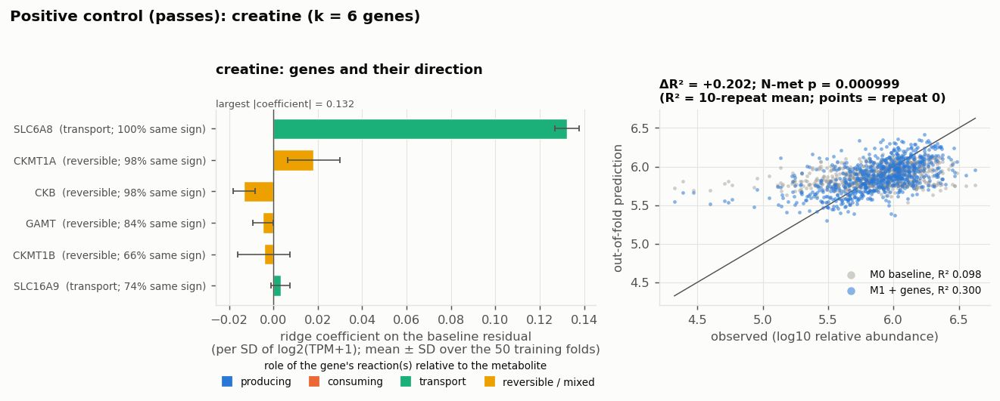
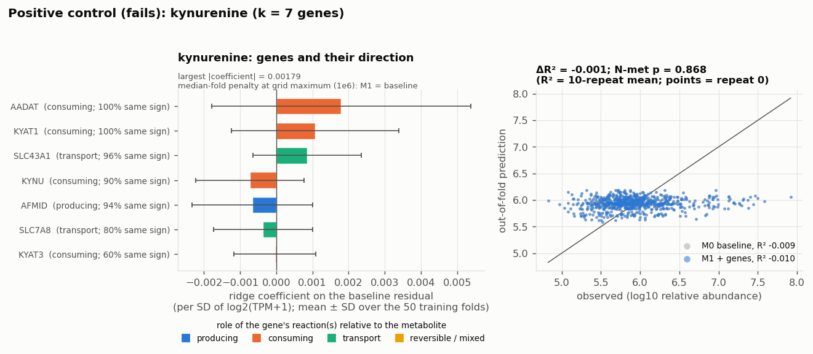

# Case studies

**Project:** MetaboNet · **Date:** 2026-11-16 · **Phase 4** (`research_plan.md` §11).
Three targets were chosen by a rule fixed before any coefficient was computed (decision D55): **the top target** (2-deoxycytidine, highest ΔR²), **the best positive control that passes** (creatine) and **the positive control that fails** (kynurenine). Nothing was added to the analysis for these cases: the figures and tables show the same models that produced the Phase 3 results (the refit reproduces their out-of-fold R² exactly).

**How to read the tables.** "Coefficient" is the ridge coefficient of the M1 model fitted on the baseline residual, per standard deviation of log2(TPM+1), averaged over the 50 training folds (5 folds × 10 repeats). "Same sign" is the share of those 50 fits in which the coefficient had its most common sign. "Role" is the role of the gene's reaction(s) relative to the metabolite in Human-GEM v2.0.0 (*producing* / *consuming* = irreversible in the model; *reversible* = both directions allowed, so direction is not identifiable from expression; *transport* = the metabolite on both sides). **Interpretation stays associative:** ridge coefficients in correlated gene sets are suggestive, not causal, and where a set is a list of isozymes (an OR rule in the gene-reaction rule) every member is a feature, whether or not it is the isozyme in play in a given cell line. No drop-one or single-gene model was fitted, so "largest weight" below never means "carries the signal".

| | 2-deoxycytidine | creatine | kynurenine |
|---|---|---|---|
| role in the study | top target | positive control, passes | positive control, **fails** |
| class / cluster | synthesised / nucleosides (C01) | synthesised / singleton | synthesised / singleton |
| first-neighbour genes (all → expressed) | 17 → 11 | 8 → 6 | 8 → 7 |
| R²(M0) lineage + medium | 0.101 | 0.098 | −0.009 |
| ΔR²(M1) (range over 10 repeats) | **0.302** (0.295–0.313) | **0.202** (0.196–0.212) | **−0.001** (−0.004–0.000) |
| N-met null median / 95th percentile | 0.052 / 0.083 | 0.001 / 0.017 | 0.005 / 0.023 |
| empirical p vs N-met (q) | 0.001 (0.0035) | 0.001 (0.0035) | 0.87 (0.89) |
| ΔR²(M2), all expressed genes | 0.241 | 0.101 | 0.065 |
| best of the other-target sets (post hoc) | 0.100 (39 sets) | 0.036 (43 sets) | 0.027 (38 sets) |
| out-of-fold Pearson r, repeat 0: M0 → M1 | 0.34 → 0.65 | 0.33 → 0.56 | 0.10 → 0.10 |
| missing before imputation | 0.5% | 0% | 11% |

---

## 1. 2-Deoxycytidine: the top target

{{GENES_2-deoxycytidine}}

**What the model shows.**

- **One gene carries by far the largest weight: CDA, with a negative coefficient (−0.35, same sign in all 50 fits).** The next largest coefficient is DCK at −0.063; CDA's is 5.5 times larger. In Human-GEM, CDA catalyses *deoxycytidine + H₂O → deoxyuridine + NH₃*, an irreversible consuming reaction. A negative association with a consuming enzyme is the direction the biochemistry predicts: lines with more CDA hold less deoxycytidine. DCK, the kinase that phosphorylates deoxycytidine to dCMP, is also negative (−0.063); its role is "consuming/reversible" because the model also lists reversible dCMP ⇌ deoxycytidine reactions under the same gene.
- **The dCMP-hydrolysing "producing" isozymes are mostly positive** (NT5C3A +0.057, NT5C3B +0.033, ACP2 +0.033, RBAK +0.019, NT5C2 +0.015, NT5C +0.013, all same sign in ≥ 96% of fits), in the direction expected for enzymes that release deoxycytidine from dCMP. **NT5E is the exception** (−0.040, 100% same sign): the model lists it among the producing isozymes (it shares one gene-reaction rule with the others), but NT5E is an ecto-5′-nucleotidase on the cell surface in general biochemistry, so its sign is not expected to follow intracellular production. This is a reminder that gene-level features inherit the OR rule of the model, and that signs are suggestive.
- **Transporters carry small weights** (SLC29A1 −0.027; SLC29A2 +0.009, same sign in only 76% of fits, so unstable). Equilibrative nucleoside transporters move deoxycytidine in either direction, so no sign is expected.
- **CDA is also the most variable gene in the set** (mean log2(TPM+1) 2.4, SD 2.35, above 1 in 55% of lines), while DCK is steady (4.18, SD 0.68). A high-variance gene with a strong consuming reaction is where a ridge model would put its weight whatever the metabolite, so the coefficient pattern is plausible but does not by itself prove a mechanism.

**Relation to the group results.** 2-Deoxycytidine is in the nucleoside cluster (9 targets, all network-specific). It beats all 39 comparison gene sets of other targets (best 0.100 against its own 0.302) and its own M1 beats the all-gene model (0.302 against 0.241). Both are what one dominant gene diluted among thousands in M2 would produce.

**Caveats.** The baseline already explains 10% of the variance, so part of the story is lineage; ΔR² is the gain beyond that. CDA expression and deoxycytidine come from different cultures. The model cannot say whether lower deoxycytidine is *caused* by more CDA, only that the two travel together out of fold.

---

## 2. Creatine: the best positive control that passes

{{GENES_creatine}}

**What the model shows.**

- **One transporter carries the weight: SLC6A8, positive (+0.132, 100% same sign), 7 times larger than the next gene.** In Human-GEM it is the creatine transporter (creatine ⇌ creatine, with sodium). More transporter goes with more cellular creatine, the direction expected if import shapes the intracellular pool.
- **The synthesis enzyme in the set, GAMT, has almost no weight** (−0.005, same sign in 84% of fits). The creatine kinase genes (CKB −0.013, CKMT1A +0.018, CKMT1B −0.004) are reversible in the model (creatine ⇌ phosphocreatine), so the model cannot assign them a direction, and their weights are small.
- **The amended H5 (D34) named GAMT and SLC6A8 as the in-set genes. The control passes through SLC6A8, not GAMT.** GATM, the first enzyme of synthesis, is at network distance 2 and is not in the set (expressed in 52% of lines).
- **The genes alone, with no lineage/medium stage, explain R² = 0.34**, against 0.098 for the baseline, so the signal does not depend on the baseline stage.

**Relation to the group results.** Creatine is network-specific (p = 0.001, q = 0.0035), beats all 43 other-target comparison sets (best 0.036 against its own 0.202), and M1 is twice the all-gene model (0.202 against 0.101): a one-gene signal, again diluted in M2. The SLC6A8 association also appears in the literature this project builds on (`literature_review.md` §3.2–3.3).

**Caveats.** Transporter mRNA is not transport activity. A creatine pool that follows SLC6A8 could reflect uptake from the serum in the medium, which the data cannot separate from synthesis. SLC16A9 shares the transport reaction's gene-reaction rule with SLC6A8 but has little weight (+0.003, 74% same sign).

---

## 3. Kynurenine: the positive control that fails

{{GENES_kynurenine}}

**What the model shows.**

- **The model finds nothing in this set.** All seven coefficients are at most 0.002 in absolute size (the largest 0.0018), 74 to 194 times smaller than the strongest genes of the other two cases, with 60–100% sign consistency and standard deviations at least as large as the means. The ridge penalty sits at the top of its grid (10⁶) in the median fold, so M1 collapses to the baseline: ΔR² = −0.001, p = 0.87 against N-met. The baseline itself explains nothing (R²(M0) = −0.009). The out-of-fold predictions are a flat cloud (right panel).
- **This is not a pipeline failure.** The same pipeline recovers the injected signal in 200 of 200 synthetic targets (S2), is silent on permuted targets (S1), and finds creatine, taurine and the 2-gene MNA diagnostic.
- **Expression does carry some information about kynurenine, outside this set:** the all-gene model gives ΔR²(M2) = 0.065 (no null was computed for M2, so this is descriptive only). It does not say which genes, or whether they are specific to tryptophan metabolism or reflect general cell state.

**Most likely reason (a hypothesis; not tested here): the rate-limiting genes are not first neighbours.** In Human-GEM the set contains AFMID, which makes kynurenine from *N*-formylkynurenine, and the enzymes that consume it (KYNU, AADAT, KYAT1, KYAT3), plus two amino-acid transporters. IDO1 and TDO2 make *N*-formylkynurenine from tryptophan and are one reaction further upstream (network distance 2), so they are not in the set. This fits three things already on record:

1. **The literature.** The CCLE paper links kynurenine to IDO1/IDO2/TDO2 expression (`literature_review.md` §2), and Benedetti et al. found IDO1 associated with kynurenine in CCLE while **AFMID, the next enzyme, was not** (§4.2). Here AFMID has essentially no weight (−0.0007) and little variation (mean 4.98, SD 0.72), as that predicts.
2. **The expression pattern.** IDO1 has a mean log2(TPM+1) of 0.58 and is above 1 in only 18% of lines; TDO2 has 0.91 and 30%; IDO2 0.04 and 1%. They are strongly on in a minority of lines and off in most, so a minority of lines could carry the kynurenine variation while the rest sit at baseline. That is a pattern a compact, constitutive enzyme set cannot mirror.
3. **The pre-specified note** (D34): kynurenine is the motivation for stretch goal 2 (second-neighbour sets).

**An important consequence for stretch goal 2.** Under the pre-specified expressed-gene filter (mean log2(TPM+1) ≥ 1 over the 735 lines), **IDO1 (0.58) and TDO2 (0.91) would be removed even from a second-neighbour set.** The filter was designed to be outcome-blind and to remove noise, but it also removes strongly inducible genes that are on in a minority of lines, which is the very pattern described above. Testing the hypothesis would therefore need a pre-specified change to the filter (for example, a fraction-of-lines criterion), logged before it is used.

**Other explanations considered, and what the data say.**

| Explanation (research_plan §11) | Assessment |
|---|---|
| Medium supply | Not supported: kynurenine is not a component of the RPMI-1640 or DMEM base formulations, and lineage + medium explain nothing (R²(M0) = −0.009). |
| Isomer ambiguity | Not supported: mapped as a single species with no isomer flag (Phase 1, D31/D32). |
| Hub metabolite | Not supported: the set has 8 genes (7 expressed), well below the hub range. |
| Genetic driver | Not assessed: mutation data are out of scope. |
| Post-transcriptional control | Cannot be assessed with mRNA alone. |
| Missing data | Unlikely: 11% missing before imputation, inside the 20% rule. |
| Rate-limiting genes at distance 2 | **Most likely; consistent with the literature and the expression pattern; untested here.** |

---

## 4. What the three cases show together

- **Direction can be read off when one gene dominates.** In both successful cases a single gene carries about five to seven times the weight of the next one, with a sign that matches its reaction (a consuming enzyme negative, an importer positive); the rest of the set is small and noisier. This is also why M1 beats M2 for these targets: one strong gene diluted among 12,666 shares a single penalty.
- **The first-neighbour definition matters for the failure.** Where the controlling step lies one reaction beyond the set (kynurenine), the model has nothing to find; where it is in the set (CDA, SLC6A8), the model finds it, and the gain is large.
- **Signs are suggestive, not causal.** NT5E (sign opposite to its model role), the unstable SLC29A2 and the reversible creatine kinase genes show where the signs should not be over-read.
- **What was not done:** no single-gene or drop-one models, no mutation or protein data, no second-neighbour sets, no experimental validation.
