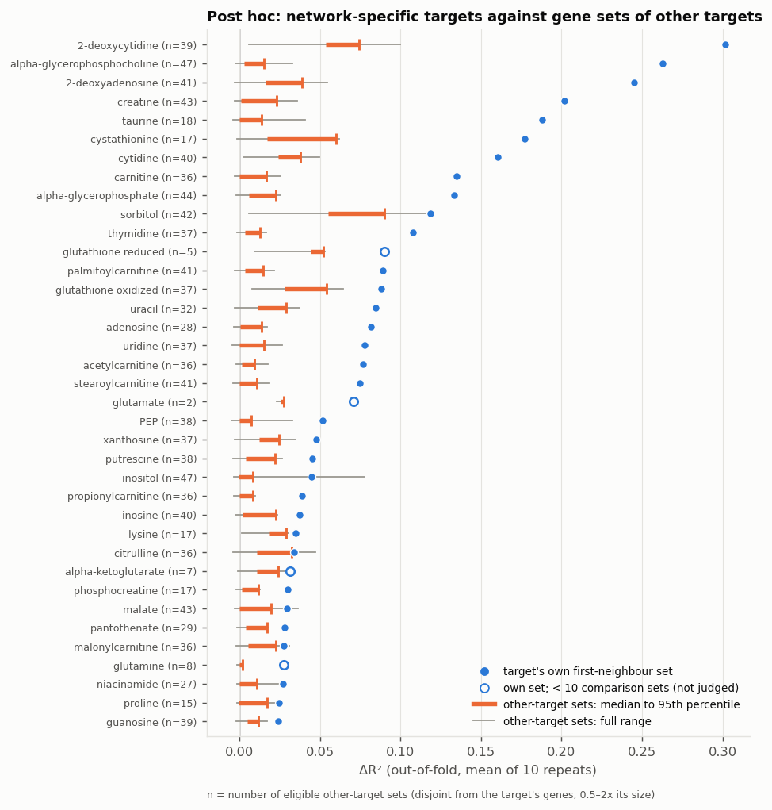

# Phase 3 Report: Main Analysis (pre-specified tests, results for every target)

**Project:** MetaboNet · **Date:** 2026-11-16 · **Scope:** Phase 3 only (`research_plan.md` §9, §13; `expectations.md` §3, §5, §6).
**What was run:** the frozen 74 targets (+ 1 labelled diagnostic) through the Phase 2 pipeline, unchanged: M0, M1, M1-enzymatic, M2, N-met and N-all (B = 1,000 each), the permuted-target control, and the four pre-specified sensitivity analyses. **No deviations after the freeze** (D52). Case studies and the write-up are Phase 4 and have not been started.
**Reproduce:** `make phase3` (resumable; about 3 h of compute in total); tables below are generated by `src/phase3/report_tables.py` from `results/phase3/`.

Metrics are **out-of-fold** (5 folds × 10 repeats, frozen folds). ΔR² is the gain over the lineage + medium baseline. Absolute values should be read as conservative: Phase 2 showed the pipeline recovers about 70% of an injected signal (S2).

---

## 1. Summary

| Hypothesis | Pre-specified criterion | Result | Verdict |
|---|---|---|---|
| **H1** network genes add information beyond lineage + medium | Wilcoxon p < 0.05 and ≥ 25% of targets with ΔR²(M1) ≥ 0.02 | median ΔR²(M1) 0.029; 51/74 (69%) ≥ 0.02; p = 7e-14 | **Supported** |
| **H2** (primary) network genes beat size-matched random *metabolic* genes | global Wilcoxon p < 0.05 and ≥ 3 network-specific targets | p = 3e-11; **37** network-specific targets; 39 targets above their own N-met 95th percentile vs 3.7 expected | **Supported** |
| H2, secondary clustered reading (D37) | same test on cluster-level observations | 56 clusters: p = 2e-8; 27 clusters above own 95th percentile | Consistent with primary |
| **H3** network genes beat size-matched random genes from the whole universe | as H2, against N-all | p = 1e-10; 38 network-specific | **Supported** |
| **H4** all-gene model at least as good as the network model | paired Wilcoxon, M2 > M1 | p = 1e-6; M2 ≥ M1 in 58/74; **but M1 beats M2 by > 0.02 for 8 targets** | **Supported on average**; the 8 exceptions are scrutinised in Section 5 |
| **H5** literature positive controls | ΔR²(M1) ≥ 0.02 and p < 0.05 vs N-met, on the in-set genes (D34) | creatine ✔, taurine ✔, **kynurenine ✘** | **2 of 3** |
| H6 target class (exploratory) | descriptive | medium-supplied targets: higher baseline R², lower ΔR², fewer network-specific calls | Direction as predicted |
| Sanity check S1 on the main run | median within ±0.005, none > 0.02 | {{S1}} | Pass |
| **Robustness** (expectations §6) | H2 classification unchanged in all four sensitivity analyses | unchanged in all four | **Robust** |

**Interpretation-matrix row (expectations §5): H1 yes, H2 yes, H3 yes.** The pre-specified reading is that *network locality carries specific predictive information across many metabolites*. The matrix also says this outcome **would contradict the random-gene result of Recon8D and must be checked carefully for leakage and target-selection bias**. Section 5 reports those checks. This report does not interpret mechanisms (Phase 4).

## 2. Per-target results (all 74 targets, sorted by ΔR²(M1))

k = expressed genes in the first-neighbour set. "N-met median / p95" are percentiles of the per-draw mean ΔR² over 1,000 random size-k metabolic-gene sets. p-values are empirical, (1 + #{null ≥ observed}) / 1001, so the smallest possible value is 0.001. q = Benjamini–Hochberg across the 74 targets. "net-spec" = q(N-met) < 0.10 **and** ΔR²(M1) ≥ 0.02. P = ΔR² on the within-stratum permuted target (should be ≈ 0). Spearman ρ is of the M1 out-of-fold predictions.

{{PER_TARGET}}

The same table, with all columns, is in `results/phase3/per_target_main.csv`.

## 3. Hypothesis tests

### H1: network genes add information beyond lineage and medium

{{H1}}

### H2 (primary): network genes versus random metabolic genes

{{H2}}

**Secondary reading (D37):** targets with overlapping gene sets are not independent, so each Jaccard > 0.5 cluster contributes one observation.

{{H2C}}

The result does not rest on the two large clusters. Of the **37** network-specific targets, **22 are among the 51 singleton targets**, and **15 are among the 23 targets in multi-target clusters**. Both large clusters are fully network-specific (nucleosides 9/9, carnitines 6/6). The three amino-acid clusters are not (0 of 8).

### H3: network genes versus random genes from the whole universe

{{H3}}

Network-specific calls against N-met and N-all agree: 37 targets in both, 1 only against N-all (aspartate), 0 only against N-met. Random metabolic genes are no more informative than random genes (median null ΔR² 0.006 against 0.0075).

### H4: network set against the all-gene ceiling

{{H4}}

### H5: literature positive controls

{{H5}}

- **Creatine** (GAMT, SLC6A8) and **taurine** (SLC6A6) pass. Both are retained when the lineage/medium stage is removed (unadjusted columns), so the baseline is not what creates the signal.
- **Kynurenine** (AFMID, KYNU) **fails**: ΔR² = −0.001, p = 0.87, and its baseline R² is also ≈ 0. The literature drivers IDO1 and TDO2 are at network distance 2 and are **not** in the set (D34). This is the pre-specified motivation for stretch goal 2 (second-neighbour sets), not a result about second-neighbour sets.

**Pipeline diagnostic (not a target; outside H1–H4; D34).** Fitted exactly like a target:

{{DIAG}}

The 2-gene set (NNMT, AOX1) gives ΔR²(M1) = 0.367 against an N-met median of 0.014, and the genes alone, without the baseline, explain R² = 0.649. This confirms that the pipeline detects the best-known single-enzyme link (NNMT–MNA) even though MNA is excluded as a target by rule 3. It is not counted anywhere in the tallies above.

### H6 (exploratory): target class

{{H6}}

Medium-supplied targets have a high baseline R² (median 0.20 against 0.03 for synthesised targets), a ΔR²(M1) near zero, and 2 of 11 network-specific calls against 29 of 51. Mann–Whitney p = 5e-4 for the excess over N-met (exploratory; group sizes are small). The direction was predicted.

## 4. Sensitivity analyses (pre-specified; expectations §6)

{{SENS}}

{{ROBUST}}

Analysis 2 uses the 67 targets that keep at least 3 expressed enzymatic genes (D36); the 7 excluded are carnosine, glucuronate, histidine, oxalate, taurine, thymine and tryptophan. Analyses 1 and 4 use their own populations and folds (D46); analysis 3 matches expression-variance deciles (D47). Per-target results: `results/phase3/per_target_sensitivity.csv`.

## 5. Checks required by the interpretation matrix (leakage and selection bias)

| Check | Result |
|---|---|
| **Permuted-target control (S1)** on the full run | {{S1}}. The pipeline manufactures no signal. |
| **Independent re-implementation.** M1 recomputed with scikit-learn's own `StandardScaler`, `LinearRegression` and `RidgeCV` on the same frozen folds (creatine, 2-deoxycytidine, α-glycerophosphate, taurine; repeats 0–2) | Identical to the pipeline to about 1e-15 for all four. Implementation error is excluded for these targets. |
| **Nulls processed identically to M1** | Same function, folds, baseline residuals and penalty grid; only the gene indices differ (S3 evidence in the Phase 2 report). |
| **Variance as an alternative explanation** | Variance-matched random sets (analysis 3) give the same H2 classification: 35 network-specific, p = 6e-11. |
| **Population and contamination** | Including haematopoietic lines (analysis 1) and excluding the 26 problematic lines (analysis 4) leave the conclusion unchanged. |
| **Same-donor leakage** | Folds are donor-grouped (validated); duplicates removed in Phase 0. |
| **Target list, gene sets and rules frozen before any result** | Commit `5ed608c`; no post-freeze deviations (D52). Selection used only IDs, network structure, expression levels, missingness and spread. |
| **Dominance by a few correlated targets** | The clustered reading (56 clusters) agrees; 22 of the 37 network-specific targets are singletons. |

**What these checks do not exclude.**

1. **Target-selection bias.** Rule 3 (3–60 expressed genes) keeps metabolites with compact network neighbourhoods; metabolites with sparse or enormous neighbourhoods (22 confidently mapped metabolites fail rule 3, among them AMP, NADP+, MNA, betaine and creatinine) are not tested, so the result applies to metabolites with compact, annotated neighbourhoods. The rules were fixed before any outcome was seen, so this limits generality, not validity.
2. **Cell state beyond lineage and medium.** The baseline has 16 lineage and 6 medium categories. A first-neighbour gene set could still carry sub-lineage cell state (differentiation, proliferation). N-met and N-all show that *generic* metabolic or random genes do not do this, but they cannot show that *no* network-specific set could. Biological case studies in Phase 4 are the next step.
3. **Different cultures.** RNA and metabolites come from different cultures and times (research_plan §2.3); associations are not causal.
4. **Magnitudes.** ΔR² is attenuated by the pipeline (about 70% recovery, S2) and by the MICE imputation shared across lines.
5. **No external data.** Nothing here transfers to tumours or to other cell-line panels.

**Comparison with the pre-stated expectations (expectations §4).**

| Pre-stated expectation | Observed |
|---|---|
| ΔR²(M1) small for most targets, median below 0.05 | median 0.029 ✔ (but 11 targets ≥ 0.10) |
| Random sets are not ≈ 0; they show modest gains | median null 0.006–0.0075: small but positive ✔ |
| Network-specific signal in about 10–25% of targets, fewer would not surprise | **50%** (37/74). **Larger than expected.** |
| M2 outperforms M1 on average | ✔ (median ΔR²(M2) 0.069), with 8 exceptions |
| R²(M0) substantial for many targets | median 0.054; high (> 0.2) mostly for medium-supplied amino acids |

### The 8 targets where M1 beats M2 by more than 0.02

2-Deoxyadenosine, 2-deoxycytidine, adenosine, cytidine, α-glycerophosphate, carnitine, creatine and palmitoylcarnitine. Expectations H4 says to scrutinise this for leakage "if M1 substantially beats M2 for *many* targets"; it is 8 of 74, not many, but the checks above apply to them, and in addition:

- Their N-met and N-all null medians are near zero (0.001–0.058; the 95th percentile of every null is below the target's observed M1 value), so there is no sign that the pipeline favours *any* small set.
- The independent re-implementation covers three of them (creatine, 2-deoxycytidine, α-glycerophosphate) and matches exactly.
- The M2 ridge penalty for these targets (3e3–1e5) is well inside the grid; **no** M2 fit for them hit the grid maximum. M2 hit the maximum of 1e6 in 68 of 3,700 fits, for 7 other targets (asparagine 30, glycine 18, threonine 14, hypoxanthine 3, and three with ≤ 1). For those targets the "ceiling" may be slightly understated; none is among the 8.
- The plausible mechanism is dilution: with one penalty shared by 12,666 standardised genes, a handful of strongly informative genes is shrunk along with thousands of uninformative ones, whereas M1 applies the penalty to 6–18 pathway-relevant genes. This is a property of single-penalty ridge, stated in `research_plan.md` §7; it is not a leak. Capture ratios above 1 should therefore be read as "M1 at or above the all-gene model", not as an inflated metric.

## 6. Figures (`results/phase3/figures/`, PNG and SVG)

1. `fig1_dr2_m1_vs_nulls`: per-target ΔR²(M1) with the N-met and N-all null distributions (5th–95th percentile and median); network-specific targets outlined; positive controls marked.
2. `fig2_dr2_m1_vs_m2`: ΔR²(M1) against ΔR²(M2), coloured by class, with the capture-ratio 0.7 line.
3. `fig3_r2_m0_by_class`: baseline R²(M0) per target, coloured by class.
4. `fig4_permuted_control`: distribution of ΔR²(P) across targets.

The case-study panels are Phase 4.

## 7. Outputs

| File | Content |
|---|---|
| `results/phase3/per_target_main.csv` | Every metric for every target (and the diagnostic): R²(M0), ΔR²(M1/M2/M1-enz), ρ, repeat range, capture ratio, null median and 95th percentile, empirical p, BH q, network-specific flags, ΔR²(P) |
| `results/phase3/global_tests.json` | All global tests, H1–H6, S1, the diagnostic, sensitivity blocks and the robustness call |
| `results/phase3/per_target_sensitivity.csv` | Per-target ΔR², p, q and calls for sensitivity analyses 1–4 |
| `results/phase3/null_draw_means_main.npz` | Mean-over-repeats ΔR² of every N-met and N-all draw |
| `results/phase3/h5_controls_unadjusted.csv` | Positive controls and diagnostic without the lineage/medium stage |
| `results/phase3/folds_all_lines.csv`, `folds_no_problematic.csv` | Folds for sensitivity analyses 1 and 4 |
| `results/phase3/RESULTS_MANIFEST.tsv` | Content hash of each of the 371 per-target arrays (arrays themselves are regenerable and not committed, D51) |
| `results/phase3/figures/` | Four core figures |

## 8. Carried into Phase 4

1. Case studies by the pre-specified rule (research_plan §11): the top target (2-deoxycytidine), a positive control (creatine or taurine) and one clear failure (kynurenine, with IDO1/TDO2 at distance 2 as the discussed reason). Show gene sets, ridge coefficients and their signs, and keep the interpretation associative.
2. Write-up: report all 74 targets (Section 2), the limitations in Section 5, the Phase 0–2 limitations (no batch labels, MICE imputation, ~70% signal recovery, adherent vs mixed growth relative to Li et al. 2022) and what a negative or positive result means.
3. Optional stretch goal, at most one (research_plan §12): second-neighbour gene sets (motivated by kynurenine). Not started.

---

## 9. Post hoc exploratory analysis: other-target null

> **POST HOC. ADDED AFTER SEEING RESULTS. DOES NOT CHANGE ANY PRE-SPECIFIED CONCLUSION.**
> Requested after the Phase 3 results and logged as a deviation (`expectations.md` §8) and as D54, with the rules fixed *before* the analysis was run. Sections 1–8 above are unchanged by it. It is exploratory and is not part of H1–H6 or the robustness call.

### 9.1 Question

The random-set nulls (N-met, N-all) show that network genes beat *random* genes. Venet et al. (2011) warn that gene sets which are *coherent* (co-expressed modules) can track cell-state axes such as proliferation and look predictive whatever their biology. Here the comparison set is made coherent: **gene sets of other targets**, which are real, curated pathway neighbourhoods. If network-specific targets still beat them, the signal belongs to the *specific* neighbourhood of the metabolite. If they do not, the signal could come from any coherent metabolic module.

### 9.2 Method (fixed in advance, D54)

1. **Eligible comparison sets for target *m*:** the frozen primary expressed gene sets of the other 73 targets (not the MNA diagnostic) that share **no gene** with *m*'s set and whose size is within **0.5× to 2×** of *k* = |G_m|.
2. **Fit:** each eligible set is fitted to *m*'s own metabolite with `run_target()` (M1 step only, B = 0) on the frozen folds and the identical two-stage pipeline. As a check, the same code path reproduces the Phase 3 ΔR² of creatine and 2-deoxycytidine to 1e-12.
3. **Statistic:** percentile rank of *m*'s own ΔR²(M1) among the comparison sets' ΔR²; "above the 95th percentile" means observed > `np.percentile(null, 95)`; the empirical p, (1 + #null ≥ observed)/(n + 1), is also given.
4. **Too few to judge:** fewer than 10 eligible sets.
5. **Reading rule, stated in advance:** among network-specific targets with ≥ 10 eligible sets, **> 50% above the 95th percentile → "specific neighbourhood"**; **< 50% → "coherent metabolic modules"**; exactly 50% → "mixed".
6. **Groups:** nucleosides = cluster C01 (9 targets), carnitines = cluster C02 (6), amino acids = the 19 proteinogenic amino-acid targets (these include the three small amino-acid clusters of D37), others = the rest.

The 74 targets together have 2,122 eligible (target, comparison set) pairs, with 2 to 50 comparison sets per target (median 31). Eligibility depends only on gene-set structure, not on any outcome.

### 9.3 Results

**Headline: 33 of the 33 network-specific targets that can be judged are above the 95th percentile of their other-target null** (4 of the 37 have fewer than 10 comparison sets and are not judged). Under the rule above, the outcome is **"specific neighbourhood"**.

{{OTHER_GROUPS}}

Nucleosides 9/9 and carnitines 6/6, the two clusters whose members share many genes, are all above the 95th percentile of sets drawn from *unrelated* pathways. For comparison, 4 of the 32 judged targets that are **not** network-specific in the primary analysis also exceed this null's 95th percentile (aspartate, ornithine, threonine, thymine); they are not used for any conclusion.

**All network-specific targets:**

{{OTHER_TABLE}}

*Reading the table.* "best" is the highest ΔR² reached by any comparison set; "Rank" is the percentage of comparison sets that the own set beats.

**Targets with fewer than 10 eligible sets (too few to judge).** Nine targets, four of them network-specific. Descriptively, all four network-specific ones have an own-set ΔR² above their best (few) comparison sets, but nothing can be concluded from 2–8 comparisons.

{{OTHER_TOOFEW}}

### 9.4 How strong is this? Margins and resolution

- **29 of the 33 judged targets beat every one of their comparison sets.** The median margin over the best comparator is 0.029 ΔR².
- **Four judged targets fall below their best comparator** while still being above the 95th percentile, mostly with weak effects. Inositol (0.045 against a best comparator of 0.078) is the clearest case:

{{OTHER_THIN}}

- **Resolution limit.** With *n* comparison sets the smallest possible empirical p is 1/(n + 1). Empirical p < 0.05 for 25 of the 33; for the other 8, five (cystathionine, lysine, phosphocreatine, proline, taurine) exceed *every* comparator but have only 15–18 sets, so p cannot go below 0.053–0.063; the remaining three (citrulline, malate, malonylcarnitine) are the weak cases just mentioned. This is why the pre-stated criterion was the 95th percentile and not a p-value.
- **The typical comparison set is no better than random metabolic genes.** Median ΔR² of the comparison sets is 0.0056 (the N-met median is 0.0060), and the median per-target 95th percentile is 0.022. Coherent pathway sets do not generally carry more signal than random metabolic genes here.
- **But some coherent sets do carry strong signal for particular metabolites.** The best individual comparisons are sorbitol predicted by the *arginine* set (ΔR² 0.118), 2-deoxycytidine by the *lactate* set (0.100), lactate by the *adenosine* set (0.097), and sorbitol by the *uridine* and *tryptophan* sets (0.093, 0.090). Sorbitol's own set (0.1184) only ties its best comparator (0.1179). Three network-specific targets have a high comparison median (2-deoxycytidine 0.053, sorbitol 0.055, reduced glutathione 0.044, the last with only 5 sets): their metabolites are predicted by many gene sets, which is what a shared cell-state axis would look like. Their own sets still lie above the 95th percentile, so the primary call stands for them too, but they are where a cell-state component is most plausible.

### 9.5 How this refines the interpretation

By the pre-stated rule (all 33 judged targets, 100% against the > 50% threshold) the evidence points to **"specific neighbourhood"** and not "coherent metabolic modules". The primary conclusion that network locality carries specific predictive information (H2) is refined, not changed: the gain for most network-specific targets is not what any equally coherent gene set of another metabolite's pathway would give, and the typical comparison set behaves like random metabolic genes.

**What this does not show.**

1. The comparison pool is the other 73 *targets'* sets: curated, but not exhaustive. A cell-state axis that none of them happens to capture (for example a proliferation signature) is not excluded.
2. Disjoint gene sets can still be co-regulated, so some comparison sets may share biology with *m*; this makes the test conservative, not lenient.
3. Four network-specific targets (α-ketoglutarate, glutamate, glutamine, reduced glutathione) cannot be judged. Only 4 of the 19 amino-acid targets are network-specific in the primary analysis (lysine and proline, judged; glutamate and glutamine, not judged), so this analysis says little about amino acids as a class.
4. Comparison sets are drawn from the same 74 pre-selected targets; the test inherits the selection limits in Section 5.
5. Eight judged targets are above the 95th percentile with an empirical p ≥ 0.05, and four sit below their best single comparator (§9.4). Individual calls for weak-effect targets (citrulline, malate, malonylcarnitine, inositol) should not be leaned on.
6. Associations remain correlational.

### 9.6 Outputs

`results/phase3/other_target_null.csv` (per target), `other_target_null_sets.csv` (every one of the 2,122 comparison fits), `other_target_null_summary.json`, and `results/phase3/figures/fig5_posthoc_other_target_null.{png,svg}`. Code: `src/phase3/other_null.py`.

