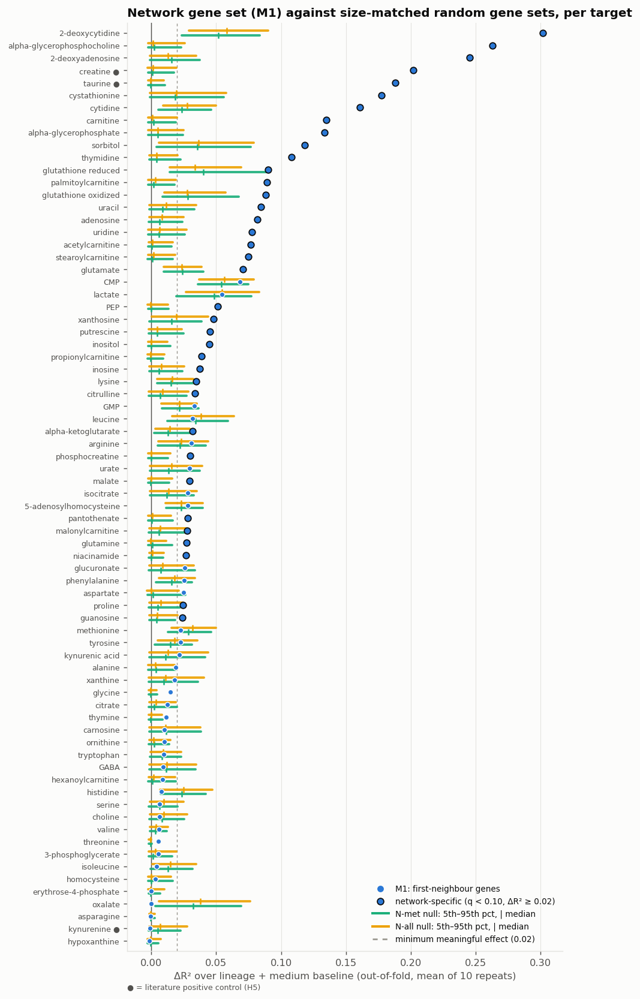

# Does a metabolite's metabolic neighbourhood predict its abundance? A controlled test in cancer cell lines

**MetaboNet final report** · 2026-11-16 · code, data provenance and every decision: this repository (`README.md`).
Detailed phase reports: [data audit](data_audit_report.md) · [network, mapping, targets](phase1_report.md) · [pipeline and controls](phase2_report.md) · [main results](phase3_report.md) · [case studies](case_studies.md) · [decision log](decision_log.md) · [pre-specified hypotheses](expectations.md).

---

## 1. Summary

I asked whether the expression of the genes in the reactions that **produce, consume or transport** a metabolite (its first neighbours in the human metabolic model Human-GEM [8]) predicts that metabolite's relative abundance in **held-out** cancer cell lines, **beyond lineage and culture medium**, and **better than size-matched random gene sets**. The hypotheses, the 74 target metabolites, the gene sets, the model and the decision thresholds were written down and frozen before any model was fitted.

| | Result |
|---|---|
| Data | CCLE 2019 metabolomics [6] + RNA-seq [7], **735 solid-tumour lines**, 74 polar metabolites with unambiguous Human-GEM matches |
| Network genes add information beyond lineage and medium (H1) | **Yes.** Median ΔR² = 0.029; 51 of 74 targets (69%) gain ≥ 0.02 |
| …and beat random *metabolic* genes (H2, primary) | **Yes.** 37 of 74 targets are network-specific; 39 exceed their own null's 95th percentile where 3.7 are expected by chance |
| …and beat random genes from the whole transcriptome (H3) | **Yes** (38 of 74) |
| …and beat gene sets of *other* metabolites' pathways (post hoc) | **Yes** for all 33 network-specific targets that can be judged |
| Robustness | The primary conclusion is unchanged in all four pre-specified sensitivity analyses |
| Literature positive controls (H5) | **2 of 3 pass** (creatine, taurine); kynurenine fails, with a probable reason |
| Largest effects | 2-deoxycytidine ΔR² = 0.30, α-glycerophosphocholine 0.26, 2-deoxyadenosine 0.25, creatine 0.20, taurine 0.19 |

**What this means:** for metabolites with compact, annotated first-neighbour gene sets, the genes of a metabolite's own reactions carry predictive information that neither lineage, medium, nor equally sized random or pathway gene sets provide. **What it does not mean:** that metabolism in general is predictable from expression, that expression causes the metabolite levels, or that the result transfers to tumours. The effect is also strikingly uneven: it is strong for nucleosides, carnitines and a few single-transporter or single-enzyme cases, and absent for most essential amino acids (Section 4).

## 2. Question and design

Prior work on CCLE shows that expression predicts many metabolites weakly (held-out R² near zero for most in one study [1]) or moderately (correlations of about 0.4 in another [2]), and that random gene sets of the same size perform about as well as metabolic ones in a third [3]. These differ mainly in what they controlled for (`literature_review.md` §3.4). None asked, per metabolite, whether the *specific neighbourhood* of that metabolite beats random sets after accounting for lineage and medium. That is the question here, with the following design:

- **Baseline M0:** lineage + culture medium. **M1:** M0 + the metabolite's first-neighbour genes. **M2:** M0 + all expressed genes (a ceiling). ΔR² = R²(model) − R²(M0), out of fold.
- **Controls:** B = 1,000 random gene sets of the same size, drawn from Human-GEM metabolic genes (N-met, the key control) and from all expressed genes (N-all); a permuted-target control; a synthetic-target recovery check; four sensitivity analyses.
- **One model class:** ridge regression in two stages (OLS baseline, then ridge on the residuals), with every learned quantity (baseline, standardisation, penalty) fitted inside the training fold. 5 folds × 10 repeats, stratified by lineage, grouped by donor so that related cell lines never straddle a fold.

## 3. Data and targets

| Step | Count |
|---|---|
| CCLE 2019 metabolomics lines (225 targeted metabolites) | 928 |
| …with RNA-seq, a current DepMap lineage, not duplicated or non-cancerous | 896 |
| …solid tumour (haematopoietic lines excluded) = **primary set** | **735** |
| Polar (HILIC) metabolites in the panel | 136 |
| …mapped 1:1 to a Human-GEM metabolite after manual review | 107 |
| …with 3–60 expressed first-neighbour genes, ≤ 20% values missing before imputation = **targets** | **74** |

Cell-line identifiers were matched across five sources (metabolomics, RNA-seq, annotations, DepMap Model.csv release 26Q3, Cellosaurus); the audit found and handled one duplicate line, 16 non-cancerous models, 26 lines flagged as misclassified or contaminated, and, in the primary set, 11 groups of same-donor lines (`data_audit_report.md`). Medium came from the original supplementary table (100% coverage, 99.5% agreement with the second source). The 74 targets are 51 synthesised, 12 mixed and 11 medium-supplied metabolites by a written rule; gene sets have a median of 10.5 expressed genes (range 3–59). The mapping of all 136 features, with the reason for every exclusion, is in `data/processed/phase1/metabolite_mapping.csv`.

## 4. Results

*Each row is a target. Dot: ΔR² of its first-neighbour genes. Bars: 5th–95th percentile and median of 1,000 random size-matched sets. All 74 targets, with every metric, are in [phase3_report.md](phase3_report.md) §2.*

| Hypothesis | Criterion fixed in advance | Result | Verdict |
|---|---|---|---|
| H1 | Wilcoxon p < 0.05 and ≥ 25% of targets with ΔR² ≥ 0.02 | p = 7e-14; 69% | Supported |
| **H2** (primary) | global p < 0.05 and ≥ 3 network-specific targets (q < 0.10 and ΔR² ≥ 0.02) | p = 3e-11; **37** network-specific | **Supported** |
| H2, clustered reading | same on 56 clusters of overlapping gene sets | p = 2e-8 | Consistent |
| H3 | as H2, against N-all | p = 1e-10; 38 | Supported |
| H4 | all-gene model ≥ network model on average | p = 1e-6; M2 ≥ M1 for 58 of 74 | Supported on average |
| H5 | controls pass: ΔR² ≥ 0.02 and p < 0.05 | creatine ✔ taurine ✔ kynurenine ✘ | 2 of 3 |
| H6 (exploratory) | target class | medium-supplied targets: baseline R² 0.20, ΔR² 0.009; synthesised: 0.03 and 0.034 | As predicted |
| S1 permuted target | median within ±0.005, none > 0.02 | −0.0004; max 0.008 | Pass |

**The pattern is uneven.** Network-specific targets are concentrated in nucleosides (9 of 9), carnitines (6 of 6) and a scattering of single-gene cases (creatine, taurine, α-glycerophosphocholine, cystathionine, PEP and others). The essential amino acids are largely explained by lineage and medium already (baseline R² up to 0.51 for threonine) and gain little from their gene sets: 2 of the 11 medium-supplied targets are network-specific, against 29 of 51 synthesised ones. 11 targets have ΔR² ≥ 0.10, and 23 stay below 0.02.

**The result is not driven by a few correlated targets.** The 37 network-specific targets include 22 of the 51 singleton targets, and the clustered reading, in which each group of overlapping gene sets counts once, gives the same answer.

**Sensitivity analyses** (all pre-specified): including haematopoietic lines (896 lines), enzymatic-only gene sets (67 targets), variance-matched random sets, and excluding the 26 flagged lines each give 27–36 network-specific targets and the same H2 classification.

**Positive controls.** Creatine and taurine are recovered, each carried by a single transporter (SLC6A8, SLC6A6). Kynurenine, the third control, shows no signal in its first-neighbour set (ΔR² = −0.001). Its literature drivers, IDO1 and TDO2 [6, 9], are one reaction upstream and are not first neighbours in Human-GEM, and are expressed above background in only 18% and 30% of lines. The 1-methylnicotinamide–NNMT link, the best known in CCLE, is excluded as a target (only 2 expressed genes) and was run as a labelled diagnostic outside every test: ΔR² = 0.37 for NNMT and AOX1 alone.

**A stronger comparison, added after seeing the results (post hoc).** Random gene sets can be beaten by any coherent gene module that tracks a cell-state axis [4]. I therefore compared each target with the gene sets of *other* targets that share none of its genes. All 33 network-specific targets with enough comparison sets exceed the 95th percentile of that null; 29 beat every comparison set. Four are weaker (inositol, citrulline, malate, malonylcarnitine), and four network-specific targets have too few comparison sets to judge (`phase3_report.md` §9). Typical comparison sets perform like random metabolic genes (median ΔR² 0.006).

## 5. Case studies

Three targets were chosen by a rule fixed beforehand (`case_studies.md`): the top target, the best passing control, and the failing control.

- **2-Deoxycytidine (ΔR² = 0.30).** One gene, **CDA**, carries about 5.5 times the weight of any other, with a negative sign: cells with more of the deoxycytidine-consuming enzyme hold less of it. The dCMP-hydrolysing isozymes are mostly positive; one (NT5E) is not, a reminder that signs are suggestive.
- **Creatine (ΔR² = 0.20).** The creatine transporter **SLC6A8** carries the signal (positive); the synthesis enzyme GAMT has almost no weight. More transporter goes with more intracellular creatine; the data cannot say whether that reflects uptake from the serum or synthesis.
- **Kynurenine (ΔR² = −0.001).** All seven coefficients are close to zero. The most likely reason is that the rate-limiting enzymes (IDO1/TDO2) lie outside the first-neighbour set; this is consistent with the literature and the expression pattern but was **not tested**. Notably, the expressed-gene filter fixed in advance would also remove IDO1 and TDO2 from a second-neighbour set, so testing it would need a pre-specified change to that filter.

## 6. How to read this result

- **Why it is plausible.** The effect sits where biochemistry predicts it: a consuming enzyme and an importer with the signs expected, nucleoside and carnitine metabolism where a few enzymes control the pool, and a near-absence of signal for nutrients supplied in the medium. The pipeline manufactures no signal on permuted targets and recovers injected signal (200 of 200 simulations).
- **Why it deserved extra scrutiny.** I had expected network-specific signal in 10–25% of targets; it was 50%. This outcome is also the one the pre-specified interpretation matrix flags as contradicting an earlier random-gene result [3]. Checks reported in `phase3_report.md` §5: an independent re-implementation with scikit-learn agrees to 1e-15, variance-matched nulls, the other-target null, the clustered reading and four sensitivity analyses. They exclude implementation error, leakage within the pipeline, variance and generic-module explanations; they do not exclude the limitations below.
- **A negative or mixed result would have been informative too.** The design could distinguish all five rows of the interpretation matrix, from "expression adds nothing beyond lineage and medium" to "network locality is specific across many metabolites"; the controls show it can neither miss a planted signal nor create one.

## 7. Limitations

1. **Selection.** Only metabolites with 3–60 expressed first-neighbour genes and a confident 1:1 mapping were tested (22 confidently mapped metabolites failed the size rule, among them AMP, NADP⁺ and 1-methylnicotinamide). The finding applies to this kind of metabolite, not the whole panel.
2. **Different cultures.** RNA and metabolites come from different cultures and time points; associations are not causal, and mRNA is a proxy for enzyme or transporter activity.
3. **Baseline resolution.** Lineage (16 categories) and medium (6) are coarse. Sub-lineage cell state could still ride on a gene set; the random and other-target nulls make this unlikely for generic sets, but cannot exclude a specific axis (for example proliferation) that none of the comparison sets captures. Medium is collinear with lineage.
4. **Relative abundances and imputation.** Values are relative, comparable across lines within a metabolite only. 9.2% of values were imputed by the data generators (MICE) and cannot be undone; 21 polar metabolites with more than 20% missing were excluded.
5. **No batch labels.** The four LC-MS batches could not be adjusted for; the planned batch sensitivity analysis was dropped.
6. **Conservative magnitudes.** Synthetic recovery was 68% of an injected signal (5th–95th percentile 44–99%), so ΔR² values are underestimates, and small effects near the 0.02 threshold are the least reliable.
7. **Population.** The primary set includes 99 suspension or mixed-growth lines (a prior study used adherent lines only [1]) and 26 lines flagged as misclassified or contaminated (analysis 4 excludes them without change).
8. **The all-gene ceiling is imperfect.** M2 uses one penalty for 12,666 genes, so it can underperform a compact set that holds one dominant gene (8 targets). Its penalty reached the top of the grid for 7 other targets.
9. **Network and mapping.** Gene sets depend on Human-GEM v2.0.0, whose gene-reaction rules contain known errors [5]; the OR-lists of isozymes make every isozyme a feature. Two HMDB identifiers are unverified (hmdb.ca blocks scripts); the mappings rest on KEGG/ChEBI and name + formula.
10. **Dependence between targets.** Targets with overlapping gene sets are not independent; the clustered reading addresses this but 56 clusters are still not 56 independent biological systems.
11. **No external validation:** one dataset, no tumours, no second cell-line panel, no experiments.

## 8. Transparency: deviations, disclosures and corrections

- **Frozen before any model:** the target list, gene-set rules, thresholds and model (commit `5ed608c`). **No change to any of these after the freeze.**
- **Before the freeze,** the following changes were made and logged with their reason: the 20% missingness rule, dropping the batch analysis, a fourth sensitivity analysis, excluding 47 chrY gene copies, excluding a lumped-protein-degradation subsystem, amending H5 to the in-set genes (three of five literature genes are not first neighbours), a clustered secondary reading, and a compute contingency (never triggered).
- **Post hoc, labelled as such:** the other-target null (Section 4), and a 200-simulation rerun of the synthetic check (the original had 20 simulations; both pass).
- **Disclosures:** a code smoke test printed the ΔR² of one real target (2-deoxycytidine) before Phase 2's formal runs, and partial results for two targets appeared while the statistics code was being tested; nothing was changed as a result.
- **Corrections made along the way:** a wrong KEGG identifier (cotinine) caught by the verification step; a Phase 2 statement about the number of synthetic simulations; the results manifest, whose first version was not reproducible because it hashed run timings (fixed; arrays unchanged); and the retrieval times of the cached KEGG/ChEBI lookups, which every rerun had overwritten (fixed; no mapping changed).
- Every decision, with date and reason, is in [`decision_log.md`](decision_log.md) (D1–D57); deviations from `expectations.md` are in its §8.

## 9. Reproducibility

| Item | Where |
|---|---|
| Raw data versions, URLs, checksums | `data/raw/MANIFEST.tsv`, `docs/data_sources.md` (Human-GEM pinned to tag v2.0.0, commit `635f533…`, files verified by git blob hash; DepMap Public 26Q3 downloaded manually because the portal blocks scripts) |
| Environment | Python 3.10.11; `requirements.txt` (pinned), `requirements.lock` (full) |
| Frozen intermediate tables with hashes | `data/processed/FREEZE.tsv`, `data/processed/phase1/FREEZE.tsv`; per-target result arrays: `results/phase3/RESULTS_MANIFEST.tsv` (`make verify-results`) |
| Entry point | `make env && make data` (needs the manual DepMap step), then `make all` (tests, audit, phases 1–4). Approximate times: phase 3 ~3 h, S2 200-simulation rerun ~1 h, others minutes; thread count is fixed to 2 for bit-identical results |
| Tests | `make test`: 89 unit tests |

**What was and was not verified.** Each stage was run and re-run with identical hashes or outputs (processed tables, folds, S1/S2, Phase 1 outputs), a recomputation of two Phase 3 targets reproduces the stored hashes under two thread settings, and the 371 stored arrays match their manifest. The complete `make all` chain was **not** executed from an empty checkout in one go.

## 10. References

1. Li H, Barbour JA, Zhu X, Wong JWH. Gene expression is a poor predictor of steady-state metabolite abundance in cancer cells. *FASEB J* 2022;36:e22296.
2. Cavicchioli MV, Santorsola M, Balboni N, Mercatelli D, Giorgi FM. Prediction of metabolic profiles from transcriptomics data in human cancer cell lines. *Int J Mol Sci* 2022;23:3867.
3. Schildcrout R, et al. Recon8D: a metabolic regulome network from oct-omics and machine learning. *bioRxiv* 2024 (published as Metab8D, *Commun Biol* 2026; numbers here are from the preprint).
4. Venet D, Dumont JE, Detours V. Most random gene expression signatures are significantly associated with breast cancer outcome. *PLoS Comput Biol* 2011;7:e1002240.
5. Luo J, et al. Reconstruction of human metabolic models with large language models. *PNAS* 2026;123:e2516511123.
6. Li H, Ning S, Ghandi M, et al. The landscape of cancer cell line metabolism. *Nat Med* 2019;25:850–860.
7. Ghandi M, et al. Next-generation characterization of the Cancer Cell Line Encyclopedia. *Nature* 2019;569:503–508.
8. Robinson JL, et al. An atlas of human metabolism. *Sci Signal* 2020;13:eaaz1482 (Human-GEM v2.0.0 as described in [5]).
9. Benedetti E, et al. A multimodal atlas of tumour metabolism reveals the architecture of gene–metabolite covariation. *Nat Metab* 2023;5:1029–1044.

The full evidence review, with the other studies considered, is in [`literature_review.md`](literature_review.md).
